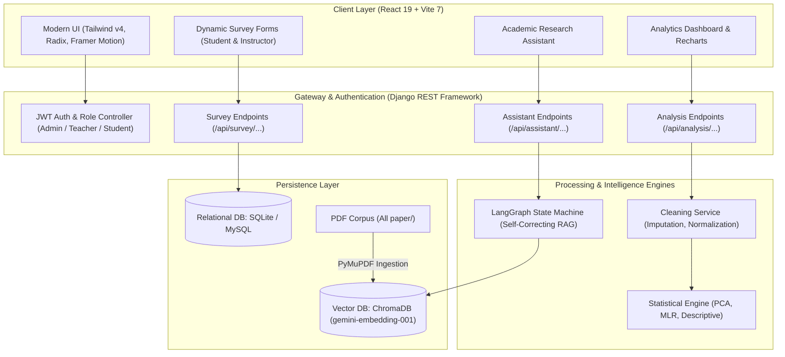
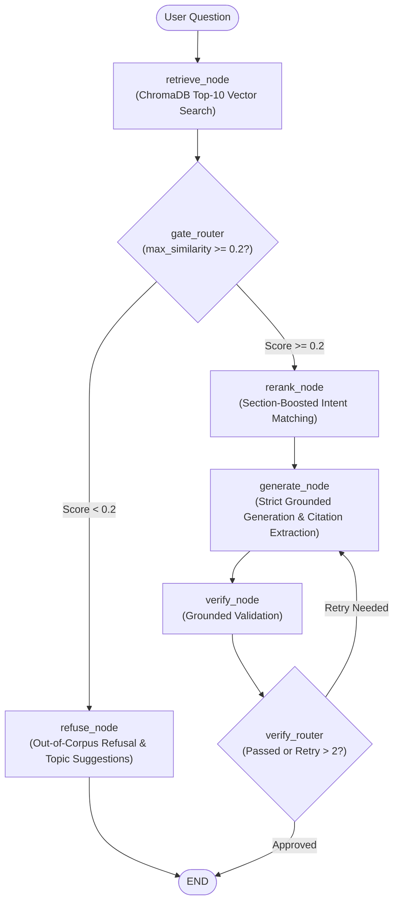

# SEPiCP: Comprehensive Project Architecture & Deep Analysis Report

**Project Location**: `/home/afzal/antigravity/sepicp/SEPiCP`  
**Date of Audit**: September 25, 2026  
**Analyst**: Antigravity Intelligence  

---

## 1. Executive Summary

**SEPiCP** (*Social Entrepreneurship & Pedagogical Innovation in Classroom Practices* / *Social Innovation Education Project*) is an advanced, full-stack educational research and empirical analysis platform. It bridges the gap between academic pedagogical research and active classroom practice by combining three core subsystems:

1. **Dual-Cohort Empirical Survey Engine**: A 75-field instructor evaluation framework paired with an 84-field student experience framework connected via dynamic course codes and secure tokens.
2. **Statistical Analytics & Data Cleaning Engine**: A scientific pipeline powered by Pandas, NumPy, and Scikit-Learn that supports automated dataset sanitation, Multiple Linear Regression, and Principal Component Analysis (PCA).
3. **Self-Reflective LangGraph Academic RAG Assistant**: An autonomous research agent orchestrated by LangGraph that grounds inquiries against a local corpus of academic research papers (`All paper/`) indexed into ChromaDB with multi-stage verification, dynamic reranking, and citation tracking.

---

## 2. High-Level System Architecture

---

## 3. Core Subsystems Deep Dive

### 3.1. The Dual-Cohort Survey & Assessment Engine
The platform implements a specialized, paired pedagogical evaluation model:

- **Instructor Survey (`InstructorSurvey` - 75 fields)**:
  - Tracks instructor demographics, course delivery format (In-Person, Hybrid, Online % synchronous), class size (1-30, 31-50, 51+), and overall engagement rating.
  - Granular pedagogical frequency metrics: real-world examples, personal stories, current events, case studies (real & hypothetical).
  - Teaching method allocation (0–100% distributions across 19 formats including interactive lectures, gamification, props, collaborative pen-and-paper).
  - Classroom organization and challenge balance metrics.
- **Student Survey (`StudentSurvey` - 84 fields)**:
  - Mirrors instructor categories for direct perceptual gap analysis.
  - Adds Section 11: 9 dedicated professor attribute dimensions (enthusiasm, relaxed demeanor, dedication to learning, subject passion, approachability, humor).
- **Relational Pairing**:
  - Automatically generates unique 5-character alphanumeric course codes (`generate_short_token`) allowing students to join without account creation.
  - Issues individual student `edit_token` values for subsequent anonymous edits.
  - Includes `AdminSurveyToDatasetView` to instantly serialize survey cohorts into clean tabular datasets for ML analysis.

### 3.2. Statistical Analysis & Data Cleaning Pipeline
Located in `backend/users/services/`:

1. **`cleaning_service.py`**:
   - Strips whitespace, standardizes column headers, coerces numeric fields, replaces missing values (mean/median for numericals, mode for categoricals), and normalizes survey ranges.
2. **`regression_service.py`**:
   - Performs Multiple Linear Regression via `sklearn.linear_model.LinearRegression`.
   - Computes $R^2$ scores, feature coefficients, intercept, mean squared error (MSE), and residual distributions.
3. **`pca_service.py`**:
   - Standardizes features using `StandardScaler`.
   - Projects multidimensional survey responses into primary components.
   - Calculates explained variance ratio and feature eigenvector loadings.
4. **`basic_analysis_service.py`**:
   - Calculates central tendency, quartiles, variance, and skewness for rapid exploratory data analysis.

### 3.3. Self-Reflective LangGraph Academic RAG Pipeline
Located in `backend/rag_pipeline/`:

- **Section-Aware Chunking (`ingest.py`)**: Uses PyMuPDF with regex patterns to extract academic headers (`abstract`, `introduction`, `methods`, `results`, `discussion`, `conclusion`, `purpose`).
- **Heuristic Section Boosting (`_section_boost`)**: Questions inquiring about "results" or "outcomes" boost candidate passages from `results` and `conclusion` sections by `+0.1` similarity.
- **Strict Citation Formatting**: Answers enforce numbered citations `[N]` referencing exact paper titles and page numbers.
- **Model Agnostic Backend**: Supports Google Gemini (`gemini-2.5-flash`), OpenAI (`gpt-4o-mini`), and Groq (`llama-3.3-70b-versatile`) with key validation endpoint (`/api/assistant/validate-key/`).

---

## 4. Frontend Architecture

- **Stack**: React 19, Vite 7, Tailwind CSS v4 (`@tailwindcss/vite`), Radix UI primitives.
- **State & Routing**: `react-router-dom` v7 with role-based routing guards (`admin`, `teacher`, `student`).
- **Data Visualization**: `recharts` for interactive scatter plots, regression lines, and variance bar charts.
- **Survey Layouts**: Multi-step categorized accordion / card layouts mirroring the 75/84 dimension schema with real-time validation.
- **Document Exporting**: Custom `docxExport.js` generating formatted Microsoft Word (.docx/.doc) research dossiers complete with academic bibliographies and executive summaries.

---

## 5. Security & Deployment Posture

- **Authentication**: JWT tokens via `djangorestframework-simplejwt` with short-lived access and sliding refresh tokens.
- **Permission Matrix**: Granular checks (`IsAuthenticated`, `IsAdminUser`, `AllowAny` for public survey access).
- **Deployment Assets**:
  - `web.config` configured for Windows IIS with `wfastcgi`.
  - Static asset distribution enabled via `whitenoise` and Django SPA catch-all router (`spa_views.py`).
  - Production WSGI / ASGI readiness.

---

## 6. Findings & Recommended Next Steps

1. **Vector Index Migration**:
   - Currently, `gemini-embedding-001` (3072 dims) is set as default. Ensure `GEMINI_API_KEY` is persistently loaded in the server environment.
2. **Database Hardening**:
   - Switch from `db.sqlite3` to MySQL/PostgreSQL in production (packages `mysqlclient` and `PyMySQL` are already present in requirements).
3. **Containerization**:
   - Recommend adding a `Dockerfile` and `docker-compose.yml` to orchestrate Frontend (Vite build / Nginx), Backend (Django + Waitress), and ChromaDB without manual OS package management.
