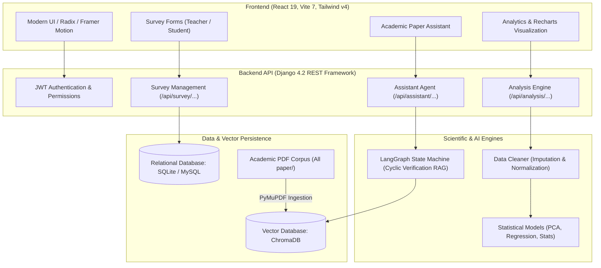

# 🎓 SEPiCP: Social Innovation Education Platform

> **Social Entrepreneurship & Pedagogical Innovation in Classroom Practices**  
> An enterprise-grade research and analytics platform combining dual-cohort pedagogical surveys, machine learning statistical pipelines, and a self-correcting LangGraph RAG research assistant.

---

## 📑 Table of Contents

- [Overview](#-overview)
- [System Architecture](#-system-architecture)
- [Key Features](#-key-features)
  - [1. Dual-Cohort Survey Engine](#1-dual-cohort-survey-engine)
  - [2. Statistical Analytics & Cleaning Pipeline](#2-statistical-analytics--cleaning-pipeline)
  - [3. Self-Reflective LangGraph RAG Assistant](#3-self-reflective-langgraph-rag-assistant)
  - [4. Academic Report Generator (.docx)](#4-academic-report-generator-docx)
- [Project Directory Structure](#-project-directory-structure)
- [Getting Started & Installation](#-getting-started--installation)
  - [Prerequisites](#prerequisites)
  - [Backend Setup (Django + DRF + LangGraph)](#backend-setup-django--drf--langgraph)
  - [Frontend Setup (React 19 + Vite + Tailwind v4)](#frontend-setup-react-19--vite--tailwind-v4)
  - [Environment Variables (.env)](#environment-variables-env)
- [Ingesting Academic Papers](#-ingesting-academic-papers)
- [REST API Endpoints Reference](#-rest-api-endpoints-reference)
- [Deployment Options](#-deployment-options)
  - [Local Development](#local-development)
  - [Production (Waitress + WhiteNoise)](#production-waitress--whitenoise)
  - [Windows Server IIS Deployment](#windows-server-iis-deployment)
- [License](#-license)

---

## 🌟 Overview

**SEPiCP** provides educational researchers, professors, and academic administrators with tools to evaluate, measure, and optimize classroom engagement and teaching strategies. 

It connects empirical classroom feedback (via a comprehensive 75-item instructor questionnaire and an 84-item student questionnaire) with advanced statistical analytics (PCA, Multiple Linear Regression) and an autonomous AI research assistant capable of grounding pedagogical recommendations against a curated library of academic literature.

---

## 🏛️ System Architecture



---

## ✨ Key Features

### 1. Dual-Cohort Survey Engine
- **Instructor Survey (75 dimensions)**: Captures pedagogical frequency, active learning protocols, real-world case usage, technology integration, and teaching method distribution (0–100% across 19 categories).
- **Student Survey (84 dimensions)**: Parallel student perception metrics plus 9 dedicated professor attribute ratings (enthusiasm, approachability, humor, dedication).
- **Zero-Friction Access**: Unique 5-character alphanumeric course codes allow students to participate anonymously without creating accounts.
- **Survey-to-Dataset Bridge**: Convert survey cohorts into clean tabular datasets with a single click.

### 2. Statistical Analytics & Cleaning Pipeline
- **Automated Data Cleaning**: Detects missing values, imputes numerical and categorical variables, normalizes feature ranges, and standardizes column schemas.
- **Multiple Linear Regression (MLR)**: Evaluates predictors of student engagement ($R^2$, feature coefficients, intercept, MSE, and residual analysis).
- **Principal Component Analysis (PCA)**: Dimensionality reduction identifying the primary pedagogical variance drivers across courses.
- **Descriptive Statistics**: Real-time generation of central tendency, variance, quartiles, and distribution metrics.

### 3. Self-Reflective LangGraph RAG Assistant
- **Cyclical Graph Architecture**: Built on LangGraph (`retrieve` $\rightarrow$ `gate_router` $\rightarrow$ `refuse` or `rerank` $\rightarrow$ `generate` $\rightarrow$ `verify` $\rightarrow$ `verify_router`).
- **Section-Aware Ingestion**: Automatically categorizes chunks by document section (`abstract`, `introduction`, `methods`, `results`, `discussion`, `conclusion`).
- **Heuristic Reranking**: Boosts relevant section candidates based on user intent (e.g. results questions prioritize conclusion/results sections).
- **Strict Grounding & Refusal**: Out-of-corpus queries trigger graceful refusals with suggested alternative topics. Every claim features exact bracketed citations `[N]` referencing paper titles and page numbers.
- **Model Flexibility**: Compatible with Google Gemini (`gemini-2.5-flash`), OpenAI (`gpt-4o-mini`), and Groq (`llama-3.3-70b-versatile`).

### 4. Academic Report Generator (.docx)
- Exports comprehensive research dossiers directly to Microsoft Word (.docx/.doc) format, including executive summaries, statistical findings, and formal APA-style bibliographies.

---

## 📂 Project Directory Structure

```text
SEPiCP/
├── backend/                           # Django REST Framework backend
│   ├── assistant/                     # Assistant endpoints & key validation
│   ├── backend/                       # Core Django settings, URLs, and SPA router
│   ├── chroma_db/                     # ChromaDB persistent vector storage
│   ├── rag_pipeline/                  # LangGraph state machine & paper ingestion
│   │   ├── graph.py                   # StateGraph assembly & conditional routing
│   │   ├── nodes.py                   # Retrieve, Rerank, Generate, Verify nodes
│   │   ├── ingest.py                  # PyMuPDF section-aware PDF chunker
│   │   ├── prompt.py                  # Strict grounding system prompts
│   │   └── state.py                   # GraphState TypedDict definition
│   ├── users/                         # Auth, models, serializers, and statistics
│   │   ├── models.py                  # User, Dataset, InstructorSurvey, StudentSurvey
│   │   └── services/                  # Cleaning, Regression, PCA, and Basic analysis
│   ├── manage.py                      # Django management script
│   └── requirements.txt               # Backend Python dependencies
│
├── frontend/                          # React 19 + Vite 7 application
│   ├── src/
│   │   ├── components/                # UI components (Sidebar, TopBar, Assistant, Tables)
│   │   ├── config/                    # Column mappings and prompt dictionary (A–CF)
│   │   ├── context/                   # AuthContext (JWT management)
│   │   ├── lib/                       # API clients, utilities, and docxExport
│   │   └── pages/                     # Application views (Dashboard, Surveys, Analysis)
│   ├── package.json                   # Frontend dependencies
│   └── vite.config.js                 # Vite build & proxy configuration
│
├── All paper/                         # Academic PDF corpus for the RAG assistant
├── deploy/                            # IIS deployment configuration
├── logs/                              # Server and execution logs
└── README.md                          # Platform documentation (this file)
```

---

## 🚀 Getting Started & Installation

### Prerequisites
- **Python**: 3.10 to 3.14
- **Node.js**: 18+ (Node 20 or 22 recommended) and `npm`

---

### Backend Setup (Django + DRF + LangGraph)

1. **Navigate to the backend directory**:
   ```bash
   cd /home/afzal/antigravity/sepicp/SEPiCP/backend
   ```

2. **Create and activate a virtual environment**:
   ```bash
   python3 -m venv .venv
   source .venv/bin/activate
   ```

3. **Install dependencies**:
   ```bash
   pip install -r requirements.txt
   ```

4. **Apply database migrations**:
   ```bash
   python manage.py migrate
   ```

5. **(Optional) Create a superuser account**:
   ```bash
   python manage.py createsuperuser
   ```

6. **Start the Django development server**:
   ```bash
   python manage.py runserver 0.0.0.0:8000
   ```

---

### Frontend Setup (React 19 + Vite + Tailwind v4)

1. **Navigate to the frontend directory**:
   ```bash
   cd /home/afzal/antigravity/sepicp/SEPiCP/frontend
   ```

2. **Install dependencies**:
   ```bash
   npm install
   ```

3. **Run the Vite development server**:
   ```bash
   npm run dev
   ```
   Open [http://localhost:5173](http://localhost:5173) in your browser.

---

### Environment Variables (.env)

Create a `.env` file in the `backend/` directory:
```ini
# Django Security
SECRET_KEY=your-django-secret-key
DEBUG=True
ALLOWED_HOSTS=*

# AI Model Provider Keys
GEMINI_API_KEY=your_google_gemini_api_key
OPENAI_API_KEY=your_openai_api_key
GROQ_API_KEY=your_groq_api_key

# Chroma Vector Store
CHROMA_DB_PATH=/home/afzal/antigravity/sepicp/SEPiCP/backend/chroma_db
```

---

## 📚 Ingesting Academic Papers

To index or update research papers into ChromaDB for the RAG Research Assistant:

```bash
cd /home/afzal/antigravity/sepicp/SEPiCP/backend
source .venv/bin/activate

# Execute PDF ingestion from the 'All paper' directory
python -c "
from rag_pipeline.ingest import ingest_folder
ingest_folder('../All paper')
"
```

---

## 📡 REST API Endpoints Reference

### Authentication & Users
| Method | Endpoint | Description | Access |
| :--- | :--- | :--- | :--- |
| `POST` | `/api/register/` | Register new user account | Public |
| `POST` | `/api/login/` | Obtain JWT access & refresh tokens | Public |
| `POST` | `/api/refresh/` | Refresh expired access token | Public |
| `GET` | `/api/profile/` | Fetch current user profile | Authenticated |

### Surveys
| Method | Endpoint | Description | Access |
| :--- | :--- | :--- | :--- |
| `GET/POST`| `/api/survey/instructor/` | List/create instructor surveys | Teacher |
| `POST` | `/api/survey/instructor/<id>/publish/` | Publish survey & generate course code | Teacher |
| `POST` | `/api/survey/student/lookup/` | Look up course by 5-char code | Public |
| `POST` | `/api/survey/student/submit/` | Submit anonymous student survey | Public |
| `GET` | `/api/teacher/dashboard/` | View aggregated survey metrics | Teacher |
| `POST` | `/api/admin/surveys/to-dataset/` | Export survey cohort to ML dataset | Admin |

### Statistical Analysis & Data
| Method | Endpoint | Description | Access |
| :--- | :--- | :--- | :--- |
| `POST` | `/api/datasets/upload/` | Upload CSV/Excel dataset | Authenticated |
| `POST` | `/api/analysis/regression/` | Run Multiple Linear Regression | Authenticated |
| `POST` | `/api/analysis/pca/` | Run Principal Component Analysis | Authenticated |
| `POST` | `/api/analysis/basic/` | Compute descriptive statistics | Authenticated |

### RAG Research Assistant
| Method | Endpoint | Description | Access |
| :--- | :--- | :--- | :--- |
| `POST` | `/api/assistant/ask/` | Query grounded paper assistant | Public / Authenticated |
| `POST` | `/api/assistant/validate-key/` | Test model API key validity | Public / Authenticated |

---

## 🚢 Deployment Options

### Local Development
Run backend on port 8000 and frontend on port 5173 with Vite's built-in proxy.

### Production (Waitress + WhiteNoise)
1. Build frontend production assets:
   ```bash
   cd frontend && npm run build
   ```
2. Copy `dist/` build output to `backend/static/site/`.
3. Launch with Waitress:
   ```bash
   cd backend
   waitress-serve --port=8000 backend.wsgi:application
   ```

### Windows Server IIS Deployment
The repository includes dedicated IIS configurations (`deploy/iis/web.config` and `backend/web.config`) utilizing `wfastcgi` for native Windows Server hosting.

---

## 📄 License

This project is licensed under the MIT License.
